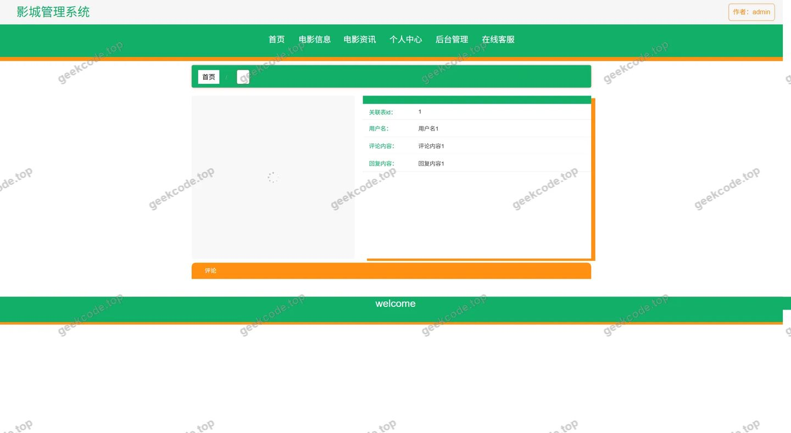
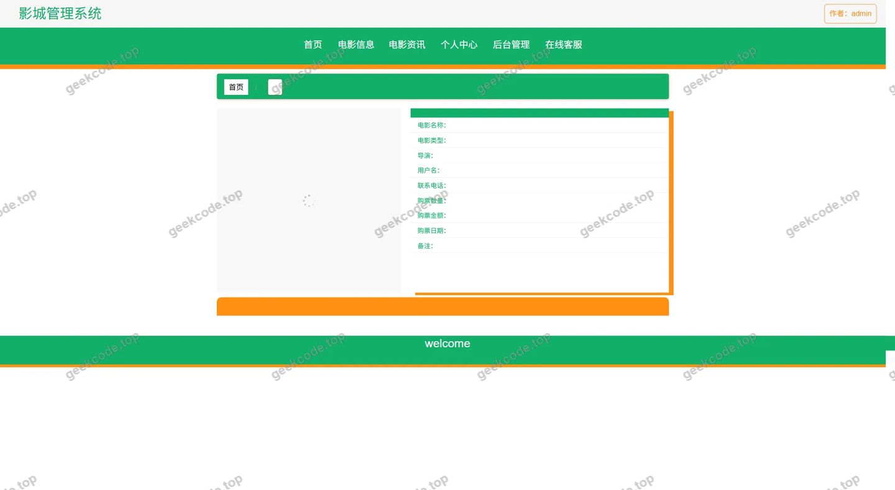
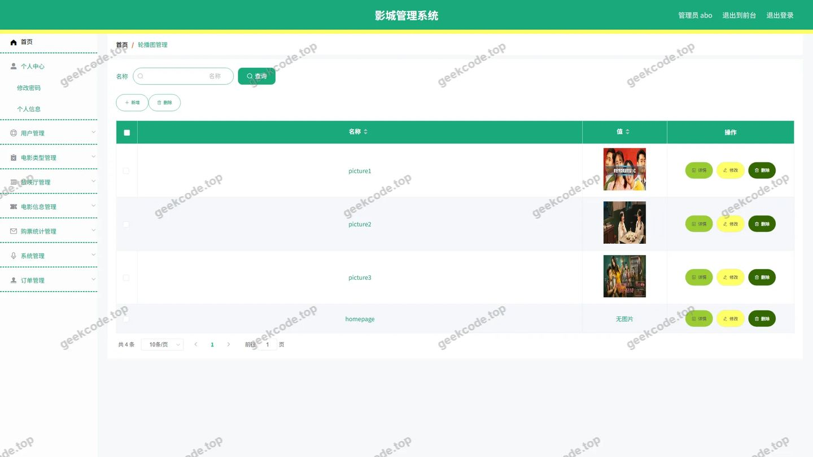
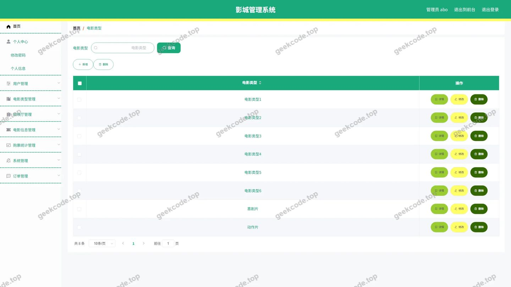
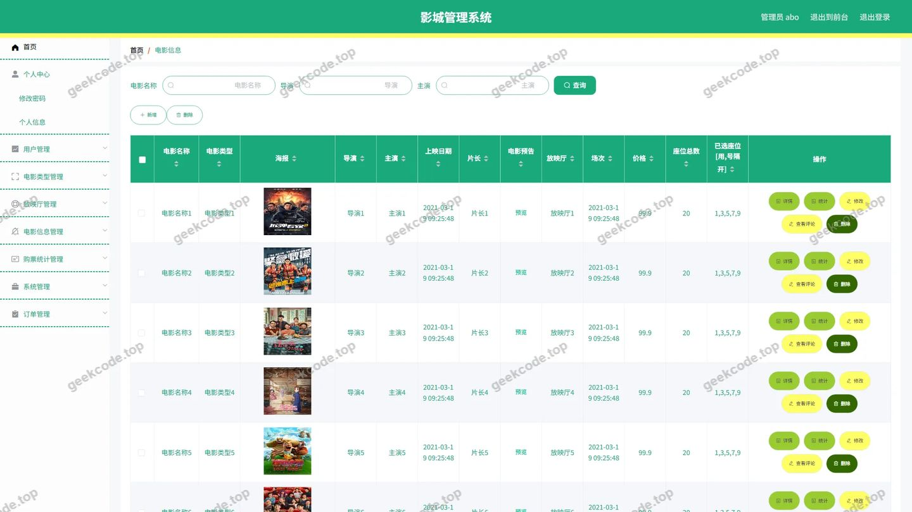
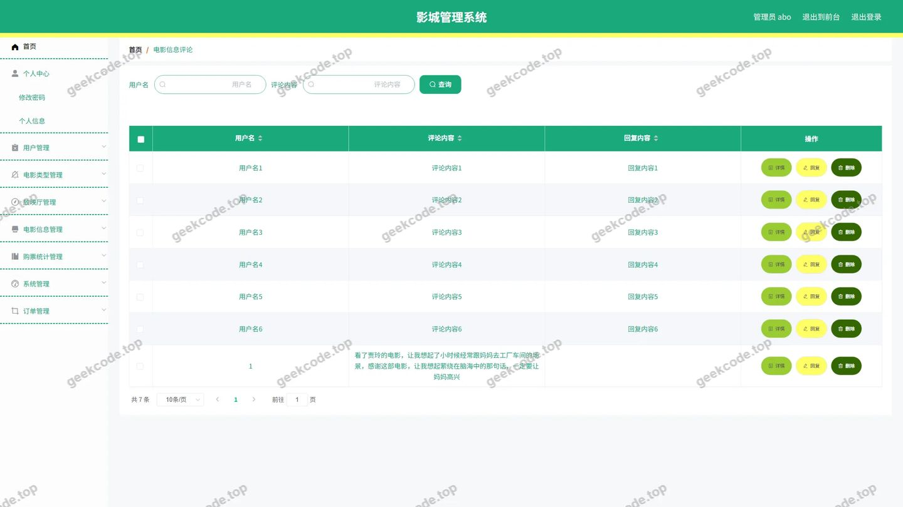
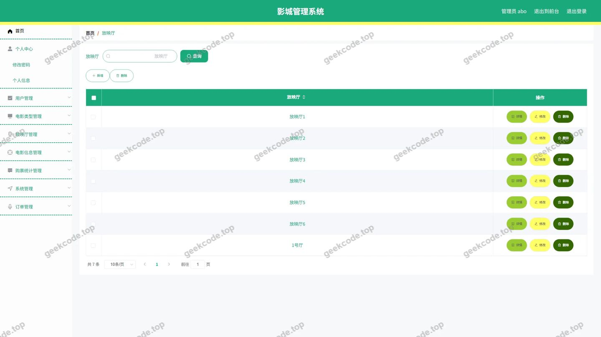
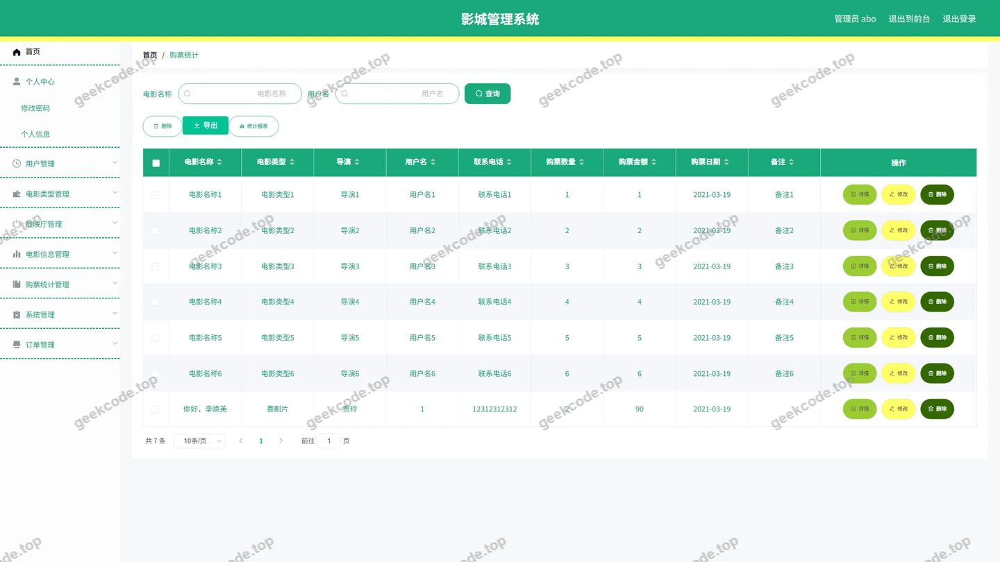
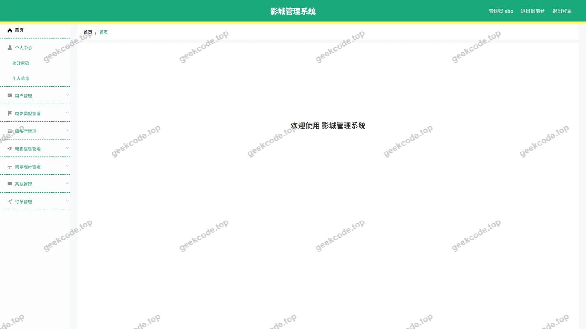
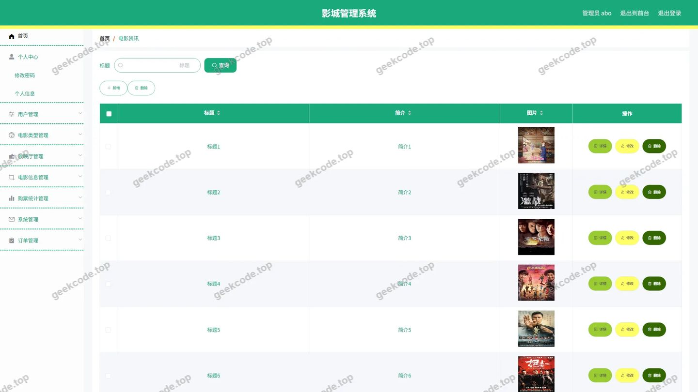

# 影城管理系统

> 🎓 **计算机毕业设计 · 影城管理系统**
>
> 本仓库只放**项目介绍 + 运行截图**（截图是站点带水印的原图，存在仓库 `images/` 里）。
>
> 👉 **完整可运行源码 / 数据库脚本 / 部署文档：[点我获取](https://geekcode.top/archives/%E5%BD%B1%E5%9F%8E%E7%AE%A1%E7%90%86%E7%B3%BB%E7%BB%9F?utm_source=github)**
>
> 💬 咨询微信：**ir9372**　|　🌐 更多项目：[极客代码 geekcode.top](https://geekcode.top/?utm_source=github)
>
> 📌 项目详情页：<https://geekcode.top/archives/%E5%BD%B1%E5%9F%8E%E7%AE%A1%E7%90%86%E7%B3%BB%E7%BB%9F?utm_source=github>

<table><td width="230" align="center"> <b>扫码加微信 ir9372</b></td><td valign="middle">📦 源码 = 项目介绍 + 全部运行截图 + 数据库 + 部署文档 👉 点上方任意截图，直接跳到 <b>极客代码 geekcode.top</b> 详情页</td></table>

---

<h1>影城管理系统</h1>
<h2>项目概述</h2>

本项目旨在构建一个基于 Web 的影城管理系统，解决传统电影院票务管理效率低、信息分散及用户购票体验不佳的问题。系统采用前后端分离架构，分为前台用户端和后台管理端。核心功能涵盖电影信息发布与管理、在线选座购票、订单处理、用户个人中心维护以及在线客服互动等模块。适用人群包括普通观影用户（进行查询、购票、评论）和影院管理员（进行内容审核、订单管理、数据统计）。技术架构上，后端基于 Spring Boot 框架结合 MyBatis-Plus 实现高效数据持久化，使用 Apache Shiro 保障系统安全；前端采用 Vue.js 框架构建响应式界面，实现了流畅的用户交互体验。

<h2>技术架构</h2>

本系统采用经典的前后端分离开发模式，整体架构清晰，易于维护与扩展。

<strong>1. 后端架构</strong>

<ul>
<li><strong>核心框架</strong>: 基于 <code>Spring Boot</code> 快速搭建应用骨架，利用其自动配置特性简化开发流程。</li>
<li><strong>数据持久层</strong>: 采用 <code>MyBatis-Plus</code> 作为 ORM 框架，在保留 MyBatis 灵活性的基础上，提供了通用的 CRUD 操作接口，显著减少样板代码。数据库连接使用 <code>mysql-connector-java</code>。</li>
<li><strong>安全认证</strong>: 集成 <code>Apache Shiro</code> 框架，负责用户的身份认证（Authentication）、授权（Authorization）及会话管理，确保后台管理接口和敏感数据访问的安全性。</li>
<li><strong>其他依赖</strong>: 引入 <code>validation-api</code> 进行参数校验，<code>commons-lang3</code> 提供常用工具类支持，<code>protobuf-java</code> 用于特定场景的数据序列化。</li>
</ul>

<strong>2. 前端架构</strong>

<ul>
<li><strong>技术选型</strong>: 虽然具体前端框架版本未在源码列表中详细展开，但根据“vue-integrated”类型及路由结构，确认前端基于 <code>Vue.js</code> 生态构建。</li>
<li><strong>交互逻辑</strong>: 通过 RESTful API 与后端进行数据交换，实现页面动态渲染。前端路由分为 <code>/news</code>, <code>/dianyingxinxi</code> 等业务路径，对应不同的视图组件。</li>
</ul>

<strong>3. 数据库设计要点</strong>

<ul>
<li>主要实体表包括：用户表 (<code>yonghu</code>)、电影信息表 (<code>dianyingxinxi</code>)、电影类型表 (<code>dianyingleixing</code>)、放映厅表 (<code>fangyingting</code>)、订单表 (<code>orders</code>)、收藏表 (<code>storeup</code>)、地址表 (<code>address</code>)、资讯表 (<code>news</code>)、评论表 (<code>discussdianyingxinxi</code>) 及购票统计表 (<code>goupiaotongji</code>)。</li>
<li>各表之间通过外键或业务ID关联，例如订单关联用户和电影，评论关联电影和用户，形成完整的数据闭环。</li>
</ul>
<pre><code class="language-mermaid">graph TD
    subgraph Frontend [前端展示层]
        User[用户浏览器] --&gt; VueApp[Vue.js 应用]
    end
    
    subgraph Backend [后端服务层]
        VueApp --&gt;|HTTP/JSON| Controller[Controller 层]
        Controller --&gt; Service[Service 层]
        Service --&gt; Mapper[Mapper 层 (MyBatis-Plus)]
        Mapper --&gt; DB[(MySQL 数据库)]
        
        Controller -.-&gt; Shiro[Shiro 安全框架]
        Shiro -.-&gt; Session[会话管理]
    end
    
    subgraph DataLayer [数据存储层]
        DB --&gt; Tables[业务数据表]
    end
</code></pre>
<h2>功能模块</h2>

系统功能划分为前台用户服务和后台管理维护两大板块。

<h3>1. 前台用户端</h3>
<ul>
<li><strong>首页与导航</strong>: 展示最新电影资讯、热门电影推荐，提供清晰的导航菜单入口。</li>
<li><strong>用户注册与登录</strong>: 新用户可以注册账号，老用户通过账号密码登录，支持个人中心访问。</li>
<li><strong>电影信息查询</strong>:</li>
<li><strong>电影列表</strong>: 浏览所有上映电影，支持按条件筛选。</li>
<li><strong>电影详情</strong>: 查看电影海报、简介、导演、演员、排片信息等。</li>
<li><strong>电影类型</strong>: 查看不同分类（如动作、喜剧、科幻等）的电影集合。</li>
<li><strong>放映厅</strong>: 查看影院各个放映厅的信息及容纳人数。</li>
<li><strong>购票与订单</strong>:</li>
<li><strong>购物车/选座</strong>: 将心仪的电影场次加入购物车或直接进入选座环节（依据截图推测为购票流程的一部分）。</li>
<li><strong>我的订单</strong>: 查看历史订单状态（待支付、已完成、已取消等），进行订单管理。</li>
<li><strong>购票统计</strong>: 个人视角的购票记录汇总分析。</li>
<li><strong>互动与内容</strong>:</li>
<li><strong>电影资讯</strong>: 阅读影院发布的新闻、活动公告。</li>
<li><strong>评论系统</strong>: 对观看过的电影发表评价，查看其他用户的评论内容。</li>
<li><strong>在线客服</strong>: 通过聊天窗口与客服沟通咨询问题。</li>
<li><strong>个人中心</strong>:</li>
<li><strong>基本信息</strong>: 修改头像、昵称、联系方式等。</li>
<li><strong>我的收藏</strong>: 管理喜欢的电影列表。</li>
<li><strong>我的地址</strong>: 维护收货地址或联系地址信息。</li>
</ul>
<h3>2. 后台管理端</h3>
<ul>
<li><strong>系统登录与安全</strong>: 管理员专属登录入口，基于 Shiro 进行权限控制。</li>
<li><strong>基础信息管理</strong>:</li>
<li><strong>电影信息</strong>: 新增、编辑、删除、上架/下架电影资料。</li>
<li><strong>电影类型</strong>: 维护电影分类字典。</li>
<li><strong>放映厅</strong>: 管理影厅名称、座位布局等信息。</li>
<li><strong>电影资讯</strong>: 发布和管理前台展示的新闻文章。</li>
<li><strong>业务运营管理</strong>:</li>
<li><strong>订单管理</strong>: 查看所有用户订单，处理异常订单，导出订单数据。</li>
<li><strong>购票统计</strong>: 全局视角的销售数据分析，辅助运营决策。</li>
<li><strong>评论管理</strong>: 审核用户评论，删除违规内容，回复用户提问。</li>
<li><strong>用户与服务管理</strong>:</li>
<li><strong>用户管理</strong>: 查看注册用户信息，禁用违规账号。</li>
<li><strong>在线客服</strong>: 接收并回复前台用户的在线咨询消息。</li>
<li><strong>收藏管理</strong>: 监控热门收藏项，了解用户偏好。</li>
<li><strong>系统配置</strong>:</li>
<li><strong>配置文件</strong>: 修改系统参数、轮播图、站点名称等全局配置。</li>
</ul>
<h2>用户角色与权限</h2>

系统主要包含两种角色：<strong>普通用户</strong>和<strong>管理员</strong>。

<h3>1. 普通用户</h3>
<ul>
<li><strong>权限范围</strong>: 仅能访问前台页面及个人中心相关功能。</li>
<li><strong>可执行操作</strong>:</li>
<li>注册、登录、退出。</li>
<li>浏览电影信息、资讯、类型、放映厅。</li>
<li>进行电影评论、查看他人评论。</li>
<li>创建订单、支付（若集成）、查看和管理自己的订单。</li>
<li>添加/移除电影到收藏夹。</li>
<li>维护个人地址信息。</li>
<li>发起在线客服对话。</li>
<li>查看个人的购票统计数据。</li>
</ul>
<h3>2. 管理员</h3>
<ul>
<li><strong>权限范围</strong>: 拥有后台管理系统的最高权限，可进行全量数据的增删改查及系统配置。</li>
<li><strong>可执行操作</strong>:</li>
<li><strong>内容管理</strong>: 对电影信息、电影类型、放映厅、电影资讯进行完整的 CRUD 操作。</li>
<li><strong>订单与财务</strong>: 查看所有订单详情，进行状态变更；查看全局购票统计报表。</li>
<li><strong>用户管理</strong>: 查看用户列表，管理用户账号状态。</li>
<li><strong>互动管理</strong>: 审核和处理电影评论，回复在线客服消息。</li>
<li><strong>系统设置</strong>: 修改系统配置文件，管理收藏数据概览。</li>
</ul>
<h2>项目特色与创新点</h2>
<ol>
<li><strong>一体化业务闭环</strong>: 系统将内容展示（电影/资讯）、社交互动（评论/客服）与商业交易（购票/订单）深度融合，为用户提供从“发现兴趣”到“完成消费”再到“反馈分享”的完整体验路径。</li>
<li><strong>多维度的数据统计</strong>: 不仅提供基础的订单管理，还专门设计了“购票统计”模块（前台个人视角+后台全局视角），帮助用户回顾观影足迹，同时为管理者提供直观的销售数据支撑，体现了数据驱动运营的理念。</li>
<li><strong>即时通讯集成</strong>: 内置在线客服聊天功能（ChatController），打破了传统静态网站的局限，增强了用户与平台之间的实时互动能力，提升了服务响应速度和用户满意度。</li>
<li><strong>灵活的评论体系</strong>: 独立的评论管理模块支持用户对电影信息进行多维度评价，既丰富了网站内容，又形成了良好的社区氛围，有助于潜在观众参考真实评价做出购票决策。</li>
</ol>
<h2>部署环境</h2>

为确保系统正常运行，需准备以下软硬件环境：

<ul>
<li><strong>操作系统</strong>: Windows 7/10/11, Linux (CentOS/Ubuntu), macOS。</li>
<li><strong>Java 运行环境</strong>: JDK 1.8 或更高版本。</li>
<li><strong>数据库</strong>: MySQL 5.7 或 MySQL 8.0。</li>
<li><strong>Web 服务器</strong>: 内置 Tomcat (由 Spring Boot 提供) 或独立部署 Nginx/Apache。</li>
<li><strong>前端构建工具</strong>: Node.js (建议 v14+), npm/yarn (用于编译 Vue 前端代码)。</li>
<li><strong>开发工具</strong>: IntelliJ IDEA 或 Eclipse (后端开发), VS Code (前端开发)。</li>
<li><strong>其他依赖</strong>: Maven (用于管理 Java 依赖包)。</li>
</ul>
<h2>五、技术特性</h2>
<ul>
<li>前后端集成部署，前端资源打包至后端 static 目录</li>
<li>使用 MyBatis-Plus 简化数据访问层开发</li>
<li>集成 Shiro 权限框架实现角色权限控制</li>
</ul>
<h2>六、功能模块截图</h2>
<h3>前台用户端</h3>
<h4>前台首页</h4>

<h4>前台登录页</h4>

<h4>前台注册页</h4>

<h4>前台-电影信息列表</h4>

<h4>前台-电影资讯列表</h4>

<h4>前台-电影信息评论列表</h4>

<h4>前台-购物车列表</h4>

<h4>前台个人中心</h4>

<h4>前台-我的地址列表</h4>

<h4>前台-我的订单列表</h4>

<h4>前台-我的收藏列表</h4>

<h4>前台-电影信息-详情</h4>

<h4>前台-电影资讯-详情</h4>

<h4>前台-电影类型列表</h4>

<h4>前台-放映厅列表</h4>

<h4>前台-购票统计列表</h4>

<h4>前台-电影信息评论-详情</h4>

<h4>前台-购票统计-详情</h4>

<h3>后台管理端</h3>
<h4>后台-在线客服</h4>

<h4>后台-系统配置</h4>

<h4>后台-电影类型</h4>

<h4>后台-电影信息</h4>

<h4>后台-电影信息评论</h4>

<h4>后台-放映厅</h4>

<h4>后台-购票统计</h4>

<h4>后台首页</h4>

<h4>后台-登录</h4>

<h4>后台-公告信息</h4>

<h4>后台-订单-状态</h4>

<h4>后台-收藏</h4>

---

## 获取完整源码

| 项目 | 说明 |
| --- | --- |
| 项目名 | 影城管理系统 |
| 运行截图 | 本文 30 张（站点带水印原图，仓库 `images/` 目录） |
| 完整源码 | [https://geekcode.top/archives/%E5%BD%B1%E5%9F%8E%E7%AE%A1%E7%90%86%E7%B3%BB%E7%BB%9F?utm_source=github](https://geekcode.top/archives/%E5%BD%B1%E5%9F%8E%E7%AE%A1%E7%90%86%E7%B3%BB%E7%BB%9F?utm_source=github) |
| 咨询微信 | **ir9372**（备注：jingpin-yuanma） |
| 更多项目 | [极客代码 geekcode.top](https://geekcode.top/?utm_source=github) |

> 需要源码、部署、改配置、跑不起来等问题，加微信 ir9372 沟通，说明项目名即可。
